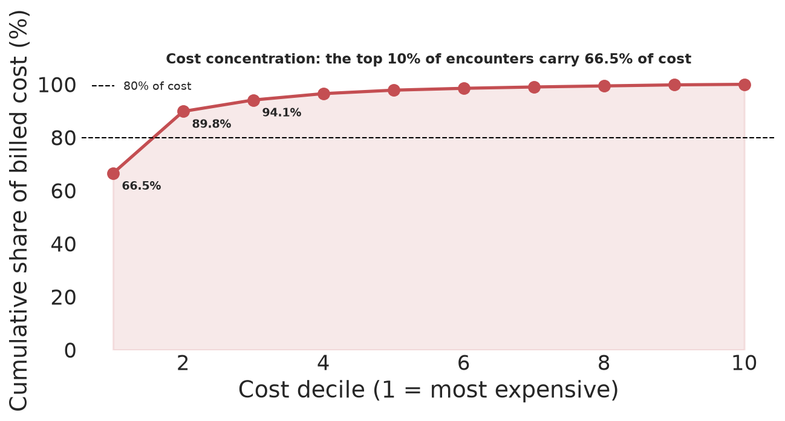
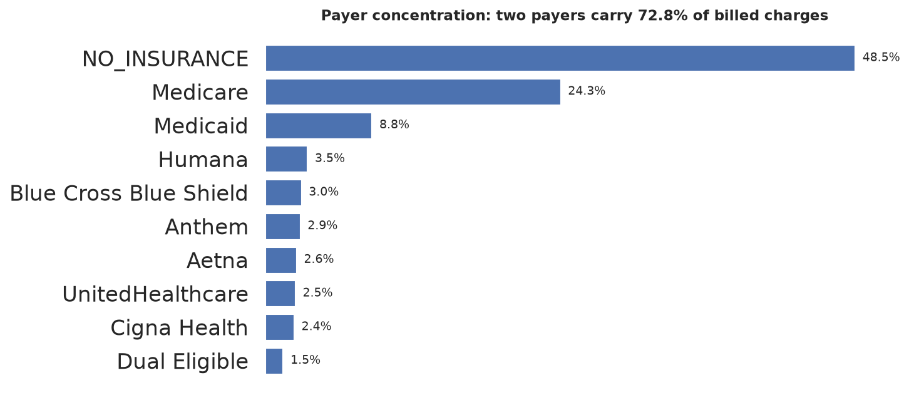
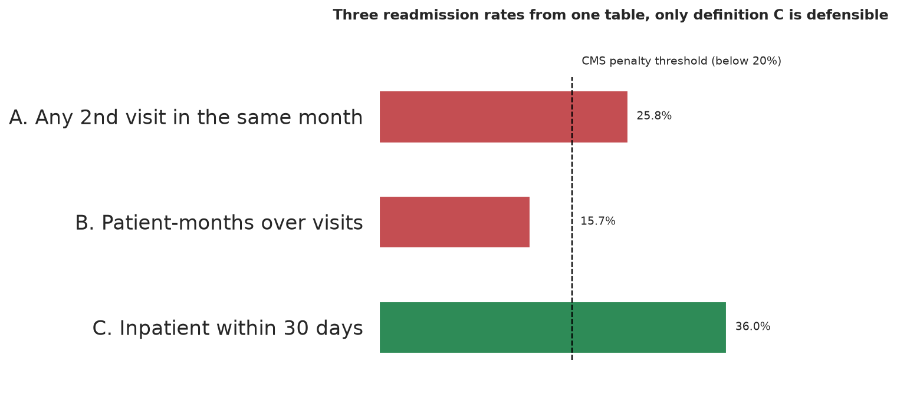
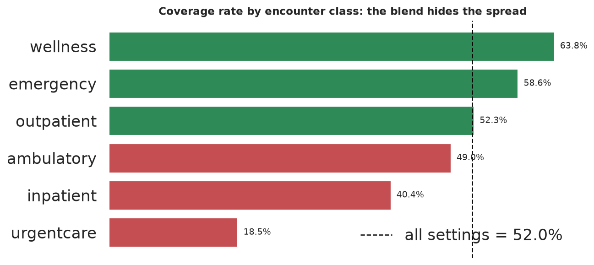
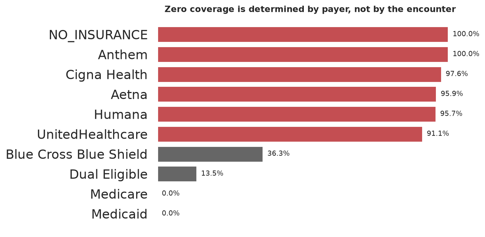
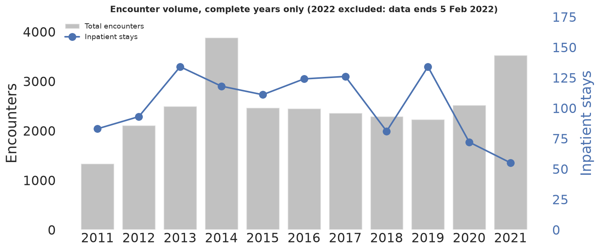

# Hospital Analytics: Cost, Payers and Inpatient Operations

**Business question:** where should care-management effort and payer-contracting attention go?

**Prepared for:** hospital finance and operations leadership deciding where to place care-management
staff and which payer relationships to prioritise.

**Data:** 27,891 encounters, 47,701 billed procedures, 974 patients, 10 payers, one facility,
2011-01-02 to 2022-02-05. The source is the Synthea synthetic patient record set (Massachusetts General
Hospital sample), so the hospital described here is simulated. The measures, the queries and the
judgement about which numbers hold up are not.

---

## Executive summary

| Measure | Value | Decision it informs | Status |
|---|---|---|---|
| Cost concentration | top 10% of encounters carry **66.5%** of billed cost | Care-management targeting | Reportable |
| Payer concentration | top 2 payers carry **72.8%** of billed charges | Contract priority | Reportable |
| Setting of care | **95.9%** same-day contact, **1,135** inpatient stays | Capacity and staffing | Reportable |
| Inpatient length of stay | **1.0 day** median, 1.54 days mean | Bed capacity | Reportable, median preferred |
| 30-day readmission | **36.0%** of inpatient stays | Quality programme | Reportable |
| Cost per inpatient stay | **$7,958** against $3,651 blended | Care-management targeting | Reportable |
| Patient panel | **576 of 974** aged 65 or older | Service-line demand | Reportable |
| Payer coverage rate | **30.6%**, a **$70.4M** billed-vs-covered gap | Revenue cycle | Not reportable: measures the data generator |

**Where the money is.** The most expensive tenth of encounters carries two thirds of billed cost, and
two payers carry nearly three quarters of it. A care-management programme aimed at the top decile is
aimed at 66.5% of the spend, and contracting is a two-payer conversation.

**The one number not to use.** The billed-vs-covered gap. The arithmetic is correct, but whether an
encounter is covered at all is decided by which insurer it was assigned to rather than by anything
clinical, so the $70.4M describes the simulator's payer mix. Finding 5 documents the test that shows it.

## Findings

### 1. Care is overwhelmingly ambulatory, which sets the scope for everything else

**95.9%** of encounters are same-day contact and only **4.1%** are inpatient (1,135 visits). A 14-minute
wellness check and a week-long admission are rows in the same table, so "length of stay" and "cost per
visit" describe the inpatient rows only. Every measure in this analysis states the population it runs
on.

### 2. Cost is extremely concentrated

The top 10% of encounters carry **66.5%** of billed charges and the top 20% carry **89.8%**. This is the
finding a care-management decision turns on: effort aimed at the top decile is aimed at two thirds of
the spend. The average encounter bills $3,651 against a median of $279, a 13-fold gap: the average
describes the tail, not the typical visit.



*Reading the chart:* the curve reaches 66.5% at its first marker and crosses the 80% line partway
through decile 2, and decile 3 takes it to 94.1%, so the bottom seven deciles share the remaining
5.9%. It is drawn cumulatively rather than as ten bars because the decision is about how much spend a
target captures, not about the individual deciles.

### 3. Two payers carry 72.8% of billed charges

`NO_INSURANCE` alone accounts for **48.5%** and Medicare **24.3%**. Contract and relationship planning
is a two-payer conversation.



*Reading the chart:* ten bars, but only two carry material width. Everything below Medicaid (8.8%)
is under 3.5%, and the eight smallest payers together are 27.2%, so the tail is effectively flat.
The largest single counterparty is `NO_INSURANCE`, at 48.5% of billed charges.

### 4. Inpatient operations, with definitions attached

Average length of stay is **1.54 days** as a mean but **1.0 day** as a median: 1,077 of the 1,135 stays
(94.9%) are exactly one day, and two exceed 30 days (maximum 343.75). Report the median. The 30-day
inpatient readmission rate is **36.0%** (409 of 1,135) under an explicit definition.

The same table yields three defensible-sounding readmission numbers, which is the argument for writing
the definition down before the query:

| Definition | Rate | Defensible |
|---|---|---|
| Any 2nd encounter in the same month | 25.78% | No: measures visit frequency |
| Patient-months over visits (mixed units) | 15.66% | No: numerator and denominator count different things |
| Inpatient to inpatient within 30 days | **36.0%** | Yes: matches how readmission is operationalised |



*Reading the chart:* two of the three bars clear the 20% CMS penalty threshold and one does not, so
the definition changes the compliance answer, not just the magnitude. 15.7% says the programme is
fine; 36.0% says it is not.

### 5. The $70.4M revenue gap is an artifact, not a finding

Coverage comes out at **30.6%**, leaving a **$70.4M** gap on $101.5M billed, and the figures are computed
correctly. That 30.6% is dollar-weighted. Measured the way the chart below measures it, as the share of procedures
with any coverage, the all-settings rate is **52.0%** and the settings span 18.5% at urgentcare to
63.8% at wellness, so the level of the number tracks case mix either way.



*Reading the chart:* the bars and the dashed line are the same measure, the share of procedures with
any coverage. Wellness, emergency and outpatient sit above the hospital-wide 52.0%; ambulatory,
inpatient and urgentcare sit below it.

The test that settles it: whether coverage is zero is determined by **which insurer the encounter was
assigned to**, not by the claim. Every Anthem and `NO_INSURANCE` encounter has zero coverage, every
Medicaid and Medicare encounter has some, and Anthem's 703 encounters contain no partial payment at all.
A real payer mix produces a distribution, not a switch.



*Reading the chart:* a switch, not a gradient. Two payers sit at exactly 0%, four sit between 91% and
98%, and the middle is nearly empty. The gap is essentially one population: `NO_INSURANCE` is
**70.0%** of the $70.4M, and even Medicare, never at zero, contributes 7.7% because coverage is
partial whenever it is nonzero.

The charts stay in this analysis, labelled, because they are the clearest example of the difference
between a number that is *computed* and a number that is *trustworthy*, and because anyone who has seen
the 30.6% elsewhere needs to know why it cannot be used.

### 6. Volume over time

Volume peaks in 2014 at 3,885 encounters, then holds between 2,228 and 2,519 a year through 2020, which
is what makes the concentration findings safe from a shifting denominator. 2011 to 2014 is the simulated
patient panel filling up rather than a demand change, so trends are read from 2015 onward. 2021 rises to
3,530 and 2022 is a partial year.



*Reading the chart:* the bars are flat after the 2014 ramp, and the blue line drifts down from 134
inpatient stays in 2019 to 55 in 2021 while the bars rise, so the 2021 increase is ambulatory volume
rather than admissions.

## Data and method

- **Source:** [Synthea](https://github.com/synthetichealth/synthea) synthetic patient records,
  Massachusetts General Hospital sample. Synthea simulates complete lifespans, including the encounters,
  procedures and billing that follow from each simulated condition.
- **Scale:** 27,891 encounters, 47,701 billed procedures, 974 patients, 10 payers, 1 facility
- **Period:** 2011-01-02 to 2022-02-05 (2022 is partial and is excluded from trend work)
- **Grain:** one row per visit in `encounters`, one row per billed line item in `procedures`, one row
  per person in `patients`
- **Tools:** SQL for every measure, using SQLite with CTEs and window functions (`NTILE` for the cost
  deciles, `LAG` for readmission, `julianday` for durations), and Python (pandas, matplotlib) for the
  charts and the result sets

### Key fields

| Field | Meaning |
|---|---|
| `ENCOUNTERCLASS` | `ambulatory`, `outpatient`, `urgentcare`, `emergency`, `wellness`, `inpatient` |
| `START` / `STOP` | visit start and end, ISO-8601 UTC strings, differenced with `julianday()` |
| `TOTAL_CLAIM_COST` | what was billed for the visit |
| `PAYER_COVERAGE` | how much of that the payer covered (see Finding 5) |
| `REASONCODE` | SNOMED-CT reason for the visit, 70.1% empty in `encounters` and 77.5% in `procedures` |
| `CODE` | SNOMED-CT code for the procedure |

### Pipeline

```
Synthea source extract (16 MB, committed)
  └─ scripts/build_db.py           raw CSVs -> SQLite + indexes + integrity assertions
       └─ data/hospital.db         built by that script, not committed
            └─ notebooks/hospital_analytics.ipynb
                                   the whole analysis, read-only against the database,
                                   writing figures/ and outputs/ as it runs
```

`scripts/build_db.py` asserts the row counts the analysis was written against and asserts that all five
foreign keys resolve, so a regenerated Synthea run cannot silently move every headline figure.

Reproduce in full:

```bash
pip install -r requirements.txt
python scripts/build_db.py      # raw CSVs -> data/hospital.db, about 30 seconds
```

Then open the notebook, which is the analysis itself:

```bash
pip install jupyterlab
jupyter lab notebooks/hospital_analytics.ipynb
```

The notebook has one section per finding, runs its own SQL, and builds and displays the six charts. It
builds the database itself if `data/hospital.db` is missing, so it runs from a fresh clone either way.

### Repo contents

```
notebooks/hospital_analytics.ipynb   the analysis as one walkthrough, committed with its charts
scripts/build_db.py                  raw CSVs -> SQLite, with assertions on scale and integrity
data/raw/*.csv                       committed (16 MB) so the database can be rebuilt from source
data/hospital.db                     built by the script (not committed)
outputs/                             11 result sets as CSV, written by the notebook
figures/                             6 charts, one per finding
```

`data/hospital.db` is deliberately **not** committed: it is a build artifact that `build_db.py`
recreates in about 30 seconds from the committed CSVs. The notebook, the charts and the result CSVs are
committed, so every number above is readable on GitHub without running anything.

## Limitations

1. **The data is synthetic.** Readmissions and lengths of stay reflect simulated disease progression,
   not care quality. Nothing here is a clinical finding about a real hospital.
2. **Coverage and revenue figures are generator artifacts** (Finding 5) and are reported only to
   document the test that identifies them.
3. **Net revenue is not derivable.** There is no cost-to-charge ratio, no contracted rate schedule and
   no denial data, so billed charges cannot be converted into collected dollars.
4. **Diagnosis-based analysis is not available.** `REASONCODE` is empty in 70.1% of encounters
   and 77.5% of procedures, which rules out segmentation by condition.
5. **No cross-site comparison.** `organizations` holds a single simulated facility.
6. **The mean length of stay is outlier-driven.** 94.9% of inpatient stays are exactly one day, so the
   median is the representative figure.
7. **The readmission measure is simplified.** It uses `LAG()` over any prior inpatient stay, so it does
   not verify the index stay was the first, and it applies no transfer or post-discharge mortality
   exclusion. At n=1,135 the effect is small; a production measure would apply both.
8. **2022 is partial** and 2011 to 2014 is panel ramp-up, so comparisons before roughly 2015 are not
   meaningful.
9. **External benchmarks are omitted deliberately.** At 95.9% same-day contact, published inpatient
   averages do not apply to this dataset.

## Next steps

- Add an ED-to-inpatient conversion measure, stating the assumption it requires, since `ENCOUNTERCLASS`
  holds a single label per encounter
- Rebuild the concentration curve for inpatient only, to test how much of the 66.5% is a case-mix effect
- Restrict readmission to first discharges, add a transfer exclusion, and measure how far 36.0% moves
- Generalise the coverage test into a checklist for spotting generator artifacts in any dataset
